
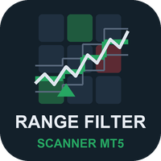

# Range Filter Scanner (MetaTrader 5 and MetaTrader 4)

A scanner indicator that shows the latest **range-filter** buy or sell signal of many symbols and timeframes in one panel on
your chart, how many bars ago it came, and whether the next timeframe agrees. It sends an alert when a new signal appears.

> **This is a showcase repository: documentation and images only. There is no source code here.** The product is sold on
> the MQL5 Market. The free single-chart indicator it builds on has public source:
> [allanninal/range-filter-signals](https://github.com/allanninal/range-filter-signals).

**Website:** [allanninal.dev/mql5 (indicators)](https://www.allanninal.dev/mql5/#indicators) · [MT4 editions](https://www.allanninal.dev/mql5/#mt4) · [allanninal.dev](https://www.allanninal.dev)
· **Contact:** message me on [LinkedIn](https://www.linkedin.com/in/allanninal/).

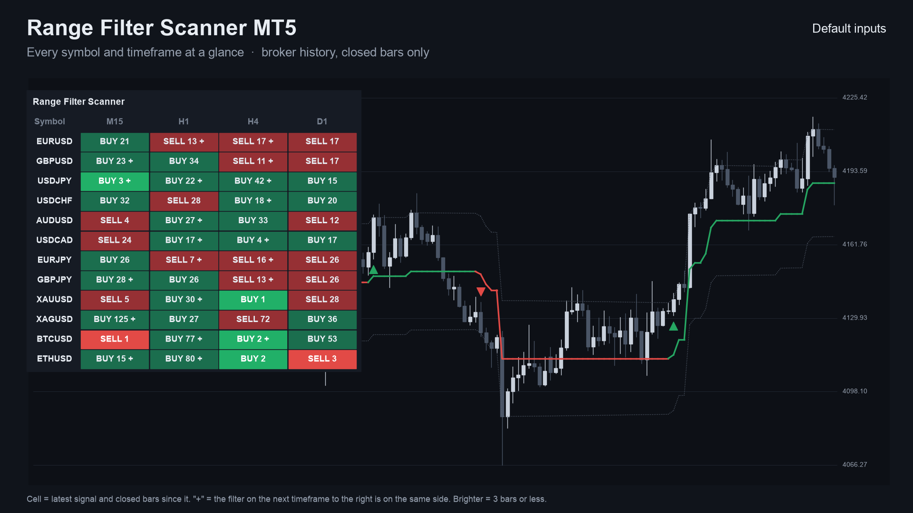

## Get it on the MQL5 Market

| Product | Platform | Price | Link |
|---|---|---|---|
| **Range Filter Scanner MT5** | MT5 | paid | <https://www.mql5.com/en/market/product/201873> |
| **Range Filter Scanner MT4** | MT4 | paid | <https://www.mql5.com/en/market/product/202402> |
| Range Filter Signals (single chart, source on GitHub) | MT5 | free | <https://www.mql5.com/en/market/product/201871> |
| Range Filter Signals MT4 (single chart, source on GitHub) | MT4 | free | <https://www.mql5.com/en/market/product/202329> |

The scanner is standalone: you do not need to install the free indicator to use it. Details, current price and the
Strategy Tester demo are on the Market pages.

## What it does

- A panel on the chart with **symbols as rows and timeframes as columns**. By default it lists the symbols in your Market
  Watch against M15, H1, H4 and D1; you can use your own lists instead.
- **In each cell:** `BUY` or `SELL` (the latest range-filter signal) and how many closed bars ago it came, for example
  `BUY 3`.
- A **`+` mark** when the filter on the next timeframe to the right points the same way. It describes agreement, not a
  promise. You can limit alerts to cells that carry a `+`.
- A **brighter cell** when the signal is recent (you choose how many bars count as fresh).
- **Click a cell** to open that symbol and timeframe.
- **Alerts:** pop-up (on by default), sound, push notification and e-mail, each switched separately. Nothing is sent while
  history loads, never twice for the same cell and bar, and not in the Strategy Tester. Cells that signal together are sent
  as one message.
- **Closed bars only.** A cell does not change after its bar has closed. It places no orders.
- Works on any symbol with history, including gold and crypto.

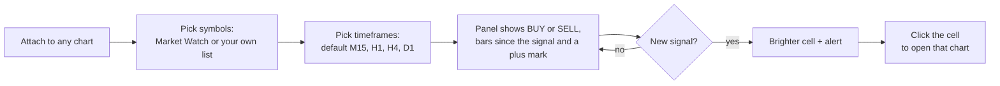

### The grid at a glance

Each cell is one symbol on one timeframe. You read the market across the whole list in a single look instead of flipping
through charts.

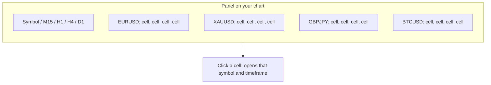

### What a cell can show

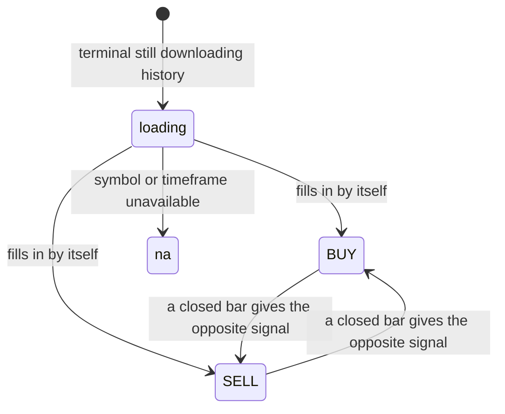

| | |
|---|---|
| 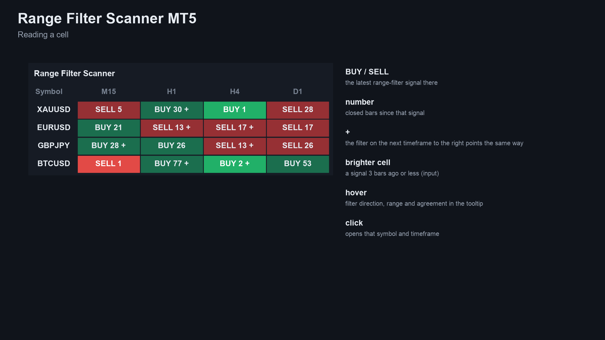 | 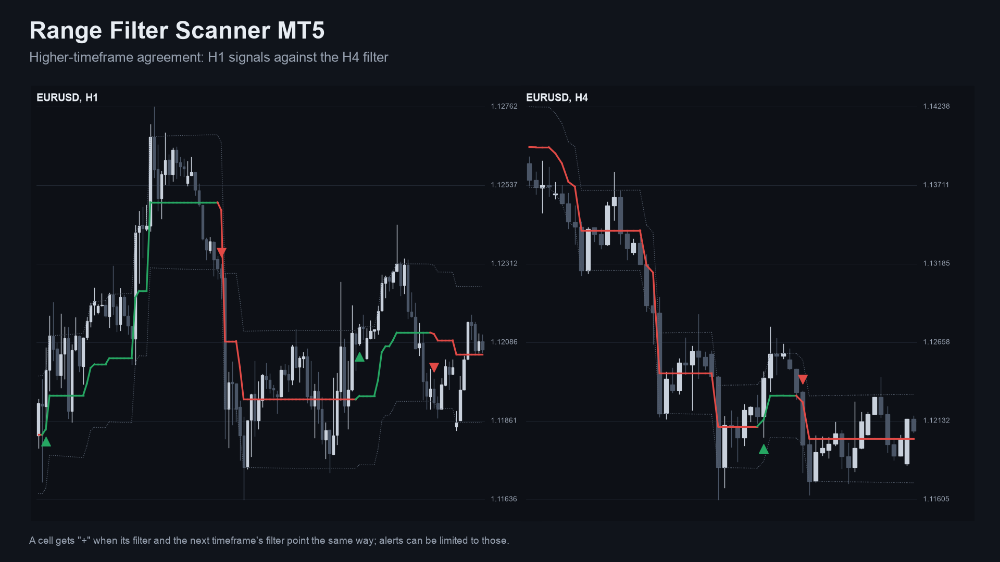 |
| 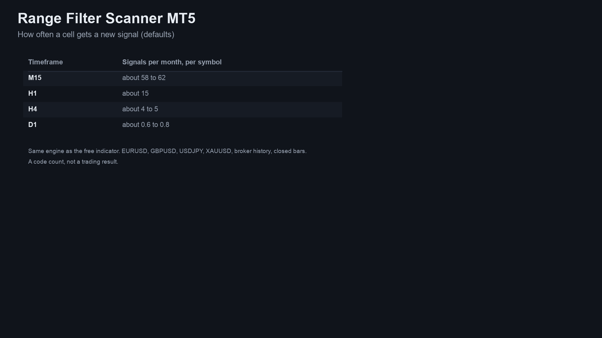 | 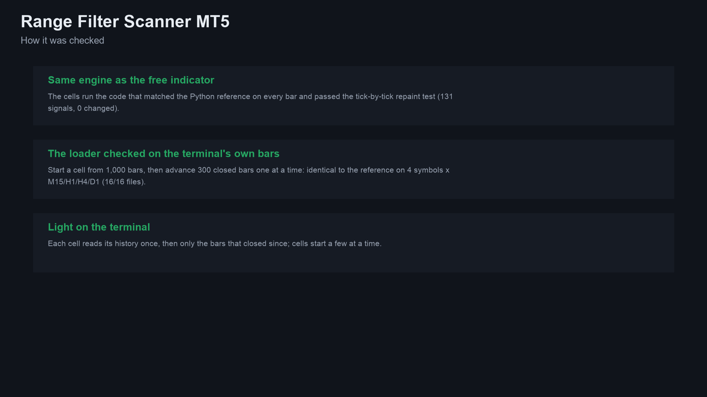 |

MT4 edition screenshots: [panel on a chart](images/mt4/01-scanner-on-chart.png), [reading a cell](images/mt4/02-reading-a-cell.png).
Some screenshots are illustrations built from broker history, not terminal captures.

## Who it is for

Traders who use the range filter on several symbols or timeframes. If you watch one chart, the free
[Range Filter Signals](https://www.mql5.com/en/market/product/201871) is enough.

## Why it was built

- The range filter is one of the most-liked trend scripts on TradingView; the free single-chart indicator covers one chart
  at a time.
- Our October 2026 market research (MQL5 Market, forums, freelance boards) found multi-symbol scanners are a recurring
  want: traders hire scanner gigs at roughly 45 to 145 USD, and a market-wide screener was an identified gap. The same
  research found the named range-filter method itself is requested only rarely by name, so this is a convenience product,
  not a claim of mass demand.
- Design rule carried over from the free indicator: trust. Cells use closed bars only, so what you saw does not change.

## How often it signals

Signals per month with the default inputs, a code count on broker history (October 2023 to October 2026, D1 ten years,
EURUSD, GBPUSD, USDJPY, XAUUSD, closed bars), not a trading result.

| Timeframe | Signals per month |
|---|---|
| M15 | about 58 to 62 |
| H1 | about 15 |
| H4 | about 4 to 5 |
| D1 | about 0.6 to 0.8 |

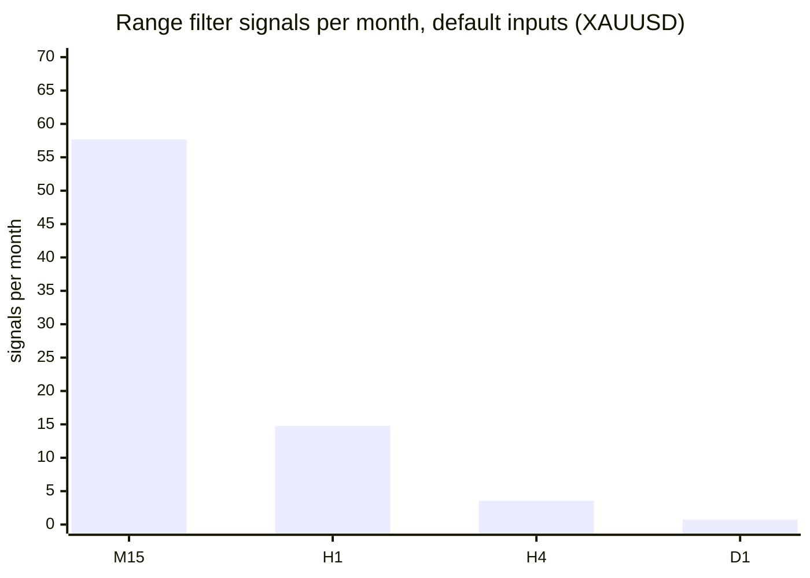

## How it was checked (results)

Every cell value was compared with an independent Python calculation. Results of the MT4 edition's final run (MetaTrader 4
Strategy Tester, 4 symbols, 2 input sets, M15 and the higher timeframes the cells read):

| Check | Result |
|---|---|
| Test files compared | 108, all pass |
| Values compared | 8,705,488, 0 differences |
| Panel counts vs the test's own cells, every tick | 8,674,390 ticks, 0 mismatches |
| Excluded | the start-up ticks of each run (125,722 in total), before every cell has its full window |
| Cells using the forming bar | none; live runs used closed bars only |

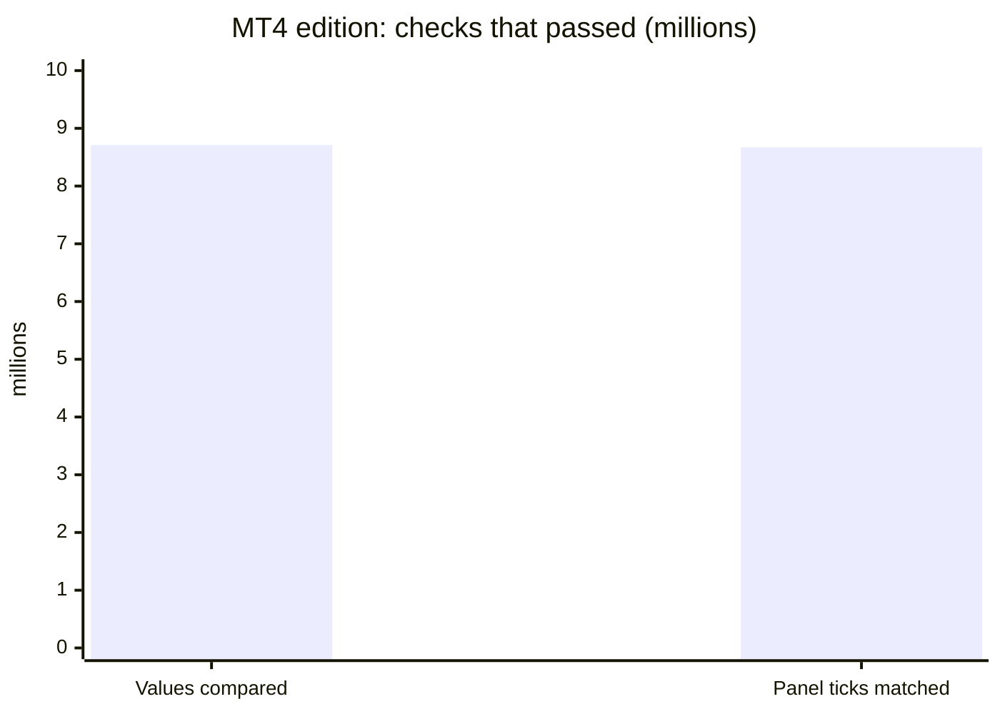

The MT5 edition runs the same calculation. Its checks: the range-filter engine matched the Python reference on 24 of 24 test
files and passed a repaint test (91,052,717 ticks, 131 signals, 0 changed), and starting a cell from 1,000 bars then
advancing 300 closed bars one at a time was identical to the reference on 4 symbols x M15/H1/H4/D1 (16 of 16 files). These
are code checks, not trading results.

## Honest limits

- A scanner shows the state of a technical rule. It does not predict the market, and past signals are no indication of
  future results. No profit or accuracy claim is made.
- It is an indicator: it places no orders and manages no risk.
- It needs the terminal running to alert, and push needs your MetaQuotes ID set up in the terminal.
- The source is not published; this repository documents what the product does and the results of its checks.

## Free vs paid

| | Range Filter Signals (free) | Range Filter Scanner (paid) |
|---|---|---|
| Scope | one chart | many symbols x timeframes in one panel |
| Output | filter line, bands and arrows on the chart | BUY / SELL cells with bars since the signal and a `+` mark |
| Alerts | pop-up, sound, push, e-mail | pop-up, sound, push, e-mail |
| MT5 | [201871](https://www.mql5.com/en/market/product/201871) | [201873](https://www.mql5.com/en/market/product/201873) |
| MT4 | [202329](https://www.mql5.com/en/market/product/202329) | [202402](https://www.mql5.com/en/market/product/202402) |
| Source | [public on GitHub](https://github.com/allanninal/range-filter-signals) | not published |

## Credits

The range-filter method is popularised by TradingView open-source scripts, notably "Range Filter [DW]" and its variants.

---

**Website:** [allanninal.dev/mql5](https://www.allanninal.dev/mql5/#indicators) · [MT4](https://www.allanninal.dev/mql5/#mt4) · [allanninal.dev](https://www.allanninal.dev)
· Questions: message me on [LinkedIn](https://www.linkedin.com/in/allanninal/). All rights reserved, see [LICENSE](LICENSE).
